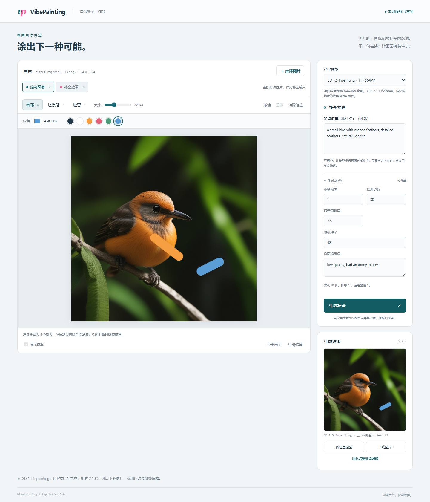

# VibePainting

一个在本地运行的 AI 图像局部补全工作台。载入图片后，可以直接绘制彩色笔迹、编辑补全遮罩，选择模型并生成结果。

**项目仍在开发中。** 当前版本使用「点击生成」的交互流程，尚未实现边画边自动补全或视频帧实时处理。



## 已有功能

- **图像编辑**：彩色画笔、常用色、吸管取色、1–200 px 笔刷、还原笔、撤销和重做。
- **遮罩编辑**：画笔与橡皮、显示/隐藏遮罩、独立清空、导出黑白遮罩。
- **四种模型**：SDXL Lightning + Dreamer ControlNet、SD 1.5 Inpainting、SDXL Inpainting、LaMa。
- **生成控制**：可选提示词、模型专用参数、随机种子；支持生成结果对比、下载和继续编辑。
- **保留画面**：生成以修改后的画布为输入，最终合成保留遮罩外的像素和原图尺寸。
- **显存管理**：只缓存一个模型，切换时释放上一个模型；同一模型的后续生成复用缓存。
- **无需前端构建**：原生 HTML/CSS/Canvas/JavaScript，后端使用 Python HTTP 服务。

## 快速开始

以下命令在项目根目录的 **Windows PowerShell** 中执行。已验证环境为 Windows、Python 3.12、RTX 4090 24 GB、PyTorch 2.4.1 + CUDA 12.4、Diffusers 0.30.3、Transformers 4.57.1。其他硬件与系统尚未完整验证；代码有 CPU 回退，但没有 CPU 性能保证。

模型需要另外下载。仓库不包含模型权重，磁盘与显存需求随模型变化；可以先只准备 SD 1.5 Inpainting。当前没有 CPU offload 或量化功能，不能把 24 GB 测试环境等同于最低显存需求。

### 1. 克隆并安装依赖

```powershell
git clone https://github.com/HANJU0427/VibePainting.git
cd VibePainting
py -3.12 -m venv .venv
.\.venv\Scripts\python.exe -m pip install --upgrade pip
.\.venv\Scripts\python.exe -m pip install torch==2.4.1 torchvision==0.19.1 --index-url https://download.pytorch.org/whl/cu124
.\.venv\Scripts\python.exe -m pip install -r requirements.txt
```

CUDA 安装命令来自 [PyTorch 历史版本说明](https://pytorch.org/get-started/previous-versions/)。需要其他 CUDA 构建时，选择与驱动和 PyTorch 2.4.1 配套的版本。项目固定了当前验证过的 Diffusers / Transformers 版本，不建议直接升级后继续沿用兼容补丁。

### 2. 准备模型

先下载一个可用模型即可启动生成。例如只下载 SD 1.5 Inpainting：

```powershell
.\.venv\Scripts\python.exe experiments/download_inpaint_models.py --models sd15_inpaint
```

其他模型按需下载：

```powershell
# SDXL Inpainting 或 LaMa；也可以在 --models 后同时指定多个名称
.\.venv\Scripts\python.exe experiments/download_inpaint_models.py --models sdxl_inpaint lama

# 原来的 Lightning 模式需要以下两份权重
.\.venv\Scripts\python.exe download_model.py
.\.venv\Scripts\python.exe download_controlnet.py
```

不传 `--models` 时，比较模型下载脚本会下载 SD 1.5、SDXL Inpainting 和 LaMa。该脚本固定了两个 Diffusers 模型的版本，并校验 LaMa 文件。网络失败会返回错误，可重新运行恢复下载；已有完整文件会复用。需要代理时，自行设置 `HTTP_PROXY` / `HTTPS_PROXY`，脚本不内置本机代理地址。

模型目录应为：

```text
models/
├── sdxl_lightning_2step.safetensors
├── controlnet-inpaint-sdxl/
│   ├── config.json
│   └── diffusion_pytorch_model.safetensors
└── comparison/
    ├── sd15_inpaint/       # 完整 Diffusers 目录，含 fp16 safetensors
    ├── sdxl_inpaint/       # 完整 Diffusers 目录，含两个文本编码器
    └── lama/big-lama.pt
```

只需存在已选择模型对应的目录。页面会禁用缺少文件的模型选项。Lightning 首次运行还可能从 Hugging Face 下载基础配置与 tokenizer 等组件；仅复制单个 checkpoint 不保证完全离线可用。SD 1.5 / SDXL Inpainting 在推理时只加载准备好的本地目录。

### 3. 启动页面

```powershell
.\.venv\Scripts\python.exe web_server.py
```

打开 **[http://127.0.0.1:8765](http://127.0.0.1:8765)**，保持终端运行；按 `Ctrl+C` 关闭服务。

也可以运行 `powershell -ExecutionPolicy Bypass -File .\start_web.ps1`。启动脚本优先使用项目 `.venv`；本机旧开发环境有一个相邻虚拟环境回退路径，新克隆项目按上面的步骤建立 `.venv` 即可。更换端口使用 `.\.venv\Scripts\python.exe web_server.py --port 8766`；显式指定解释器可使用 `.\start_web.ps1 -PythonPath '完整的 python.exe 路径'`。

## 怎么用

1. **载入图片**：选择或拖入 PNG、JPEG、WebP，文件最大 20 MB、最多 1600 万像素；透明背景会铺白底。仓库中的 `output_img2img_7513.png` 和 `output_landscape.png` 是演示及浏览器测试样例。
2. **按需直接画图**：选择「绘制图像」，修改颜色、使用吸管或还原笔。还原笔只擦除手绘笔迹，露出本次载入的图片。
3. **绘制遮罩**：切到「补全遮罩」，用粉色标记 AI 需要重绘的区域。手绘笔迹不会自动变成遮罩。
4. **选择模型并生成**：提示词可以留空；需要指定内容时可尝试英文描述。每个模型有自己的默认参数，LaMa 不使用提示词。
5. **查看并保存**：按住「看原图」对比本次生成输入；下载结果，或点击「用此结果继续编辑」。无需调用 AI，也可以直接导出画布。

图像笔迹与遮罩独立保存，清空其中一个不影响另一个。撤销和重做按实际操作顺序恢复，最多保留 20 个操作，内存较大时提前释放旧记录。切换模型会保留画布、遮罩、提示词及已有结果，当前页面内也会记住各模型调过的参数。

| 快捷键 | 功能 |
| --- | --- |
| `P` / `M` | 绘制图像 / 补全遮罩 |
| `B` / `E` | 画笔 / 还原笔或遮罩橡皮 |
| `I` | 图像模式下吸管取色 |
| `Ctrl/Cmd+Z` | 撤销 |
| `Ctrl/Cmd+Shift+Z` 或 `Ctrl/Cmd+Y` | 重做 |

生成期间会锁定输入。刷新页面不会保存尚未导出的图像和遮罩；浏览器仅尝试恢复最近提交的任务。服务只在内存中保留最近一个任务，重启后任务状态丢失。

## 模型与默认参数

| 模型 ID | 模型 | 工作尺寸 | 步数 | 引导 | 重绘强度 |
| --- | --- | --- | --- | --- | --- |
| `lightning` | SDXL Lightning + Dreamer ControlNet | 1024 | 2 | 0 | 1.0 |
| `sd15_inpaint` | SD 1.5 Inpainting | 512 | 30 | 7.5 | 1.0 |
| `sdxl_inpaint` | SDXL Inpainting | 1024 | 20 | 8.0 | 0.99 |
| `lama` | LaMa | 1024 | — | — | — |

工作尺寸指模型内部处理的正方形边长；输入等比缩放、补边，生成后恢复原始尺寸再合成。Lightning 额外使用默认 0.3 的 ControlNet 结构约束。首选模型沿用 Lightning；如果未下载，会自动选取其他已就绪模型。浏览器会记住上次的模型选择。

效果取决于图片、遮罩大小、提示词和种子。遮罩外像素不变，并不保证遮罩边缘视觉上完全无缝。LaMa 适合基于上下文修补，不能通过提示词指定新物体；扩散模型可能重新解释遮罩内的手绘内容。SDXL 默认使用原图初始化和 0.99 的强度。更多说明见 [模型切换](MODEL_SWITCHING.md) 和 [图像画笔](PAINTING.md)。

## 项目结构

```text
web/                            # 页面、画布交互和样式
web_server.py                   # 本地 HTTP API、请求校验、后台生成任务
model_catalog.py                # 模型目录、默认参数、本地文件检查
inpaint_engine.py               # 串行推理、模型切换、最终图像合成
sdxl_lightning_inpaint.py        # Lightning + ControlNet 加载与命令行接口
download_model.py               # Lightning 权重下载
download_controlnet.py          # Dreamer ControlNet 下载
experiments/                    # 模型下载、填充方式与提示词对照实验脚本
tests/                          # Python 测试、浏览器交互及真实模型测试
docs/images/                    # README 使用的页面截图
start_web.ps1                   # Windows 启动脚本
requirements.txt                # 当前兼容依赖范围
```

根目录还保留早期文生图 / 图生图 CLI（`quick_generate.py`、`quick_img2img.py` 等），见 [CLI 使用说明](USAGE.md)；根目录的 `test*.py` 是历史试验草稿，不属于下面的自动测试集，可能需要额外环境（如 Krita）。当前主要入口为本 README 中的网页工作台。`experiments/` 的历史评估脚本需要对应的本地输入图和前序实验输出；这些大批量素材和报告不随仓库发布，不能直接视为克隆即跑的基准测试集。

## 测试

安装 Python 依赖后，运行不下载权重、不进行真实模型推理的自动测试：

```powershell
.\.venv\Scripts\python.exe -m unittest discover -s tests -p 'test_*.py' -v
```

浏览器测试额外需要 Node.js、Playwright 和 Microsoft Edge。先安装测试依赖，再在单独终端启动替代推理服务：

```powershell
npm install --no-save --package-lock=false playwright
.\.venv\Scripts\python.exe tests/serve_fixture.py
```

保持该终端运行，在另一终端依次执行：

```powershell
node tests/browser_check.cjs
node tests/model_switching_browser.cjs
node tests/painting_browser.cjs
```

8767 测试服务模拟模型可用性，用固定颜色代替 AI 输出，无需下载权重，不能用于评价生成质量。浏览器截图与记录写入被 Git 忽略的 `test_artifacts/`。真实模型集成测试需要主服务 8765 空闲且四个模型全部就绪；当前脚本还要求 `nvidia-smi` 可直接运行，并只报告一张 NVIDIA GPU，以记录显存：

```powershell
.\.venv\Scripts\python.exe tests/smoke_model_switching.py
```

此前已在上述开发环境完成四模型真实生成与切换，以及图像绘制后的 SD 1.5 补全验证。测试覆盖画布保留、混合撤销/重做、触摸操作、错误恢复，以及遮罩外像素保持不变；这些结果不代表所有设备上的性能或画质保证。

## 常见问题

- **模型选项不可用**：对应权重或配置不完整，运行该模型的下载命令后刷新页面。
- **无法连接 / `ERR_CONNECTION_RESET`**：先检查服务终端、`logs/server.log` 和 `logs/native-crash.log`。保持当前页面，重启服务后可重试，避免刷新丢失画布。
- **端口已占用**：关闭旧服务或使用 `--port 8766`；多个标签页会共用同一个服务，一次只接受一个生成任务。
- **显存不足**：关闭其他 GPU 程序，或改用负担较小的模型。首轮耗时包含模型加载，切换模型后需重新加载。
- **Windows 原生库崩溃**：优先使用独立 `.venv` 和本文依赖范围。代码包含针对当前环境的 TensorFlow、scikit-learn / pyarrow、ONNX 可选导入兼容处理，升级相关包后需重新验证。
- **结果被模型检测器拦截**：服务会报告失败，并保留画布和上次结果，不将被替换的黑图当作成功输出。

服务只监听 `127.0.0.1`，没有账号体系或公共部署配置。图片在本机浏览器和本机 Python 服务之间传递；首次准备模型时需要访问相应下载站点。

## 模型来源与致谢

- [ByteDance / SDXL-Lightning](https://huggingface.co/ByteDance/SDXL-Lightning)
- [destitech / controlnet-inpaint-dreamer-sdxl](https://huggingface.co/destitech/controlnet-inpaint-dreamer-sdxl)
- [stable-diffusion-v1-5 / stable-diffusion-inpainting](https://huggingface.co/stable-diffusion-v1-5/stable-diffusion-inpainting)
- [diffusers / stable-diffusion-xl-1.0-inpainting-0.1](https://huggingface.co/diffusers/stable-diffusion-xl-1.0-inpainting-0.1)
- [LaMa](https://github.com/advimman/lama) 与 [Sanster 的 Big LaMa 权重发布](https://github.com/Sanster/models/releases/tag/add_big_lama)
- [Hugging Face Diffusers](https://github.com/huggingface/diffusers)、[PyTorch](https://pytorch.org/)

模型权重不包含在本仓库中，使用时请查看各上游项目的许可证与使用条件。本仓库目前尚未添加代码许可证。
